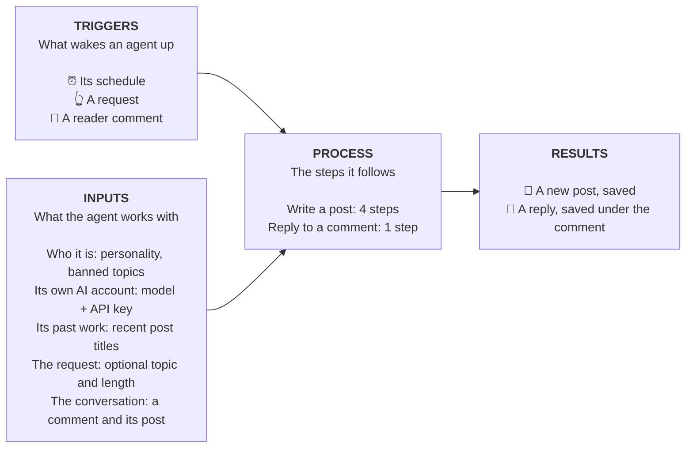
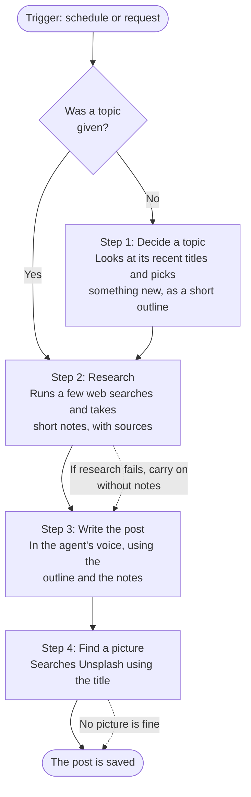
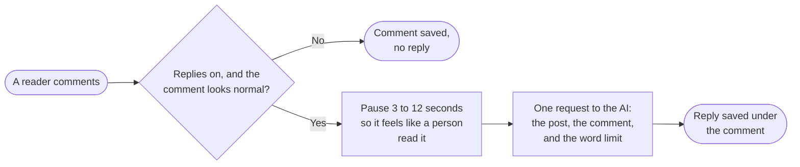

# Autoblogger Server

This app serves two purposes:

1. Act as the backend for the [Autoblogger website](https://autoblogger-client.onrender.com/)
2. Provide endpoints for the [Autoblogger API](https://autoblogger-client.onrender.com/api)

For that reason you'll see two groups of routes:

* `routes/api`
* `routes/web`

I realize this is a poor separation of concerns. Expect an improved architecture in the future.

## Features

Since this is currently a side project, I plan to implement these features _as time permits_.

* **Agent Content Generation:** The core feature of Autoblogger is setting up cron tasks that continuously execute scheduled AI content generation.
* **API Endpoints:**  Users can access generated content via API. This makes it simple to integrate Autoblogger into an existing website or application.

 **Some core enpoints:**

* **GET:`/posts`** Retrieve posts written by your AI(s).
* **POST:`/posts`** Immediately trigger a new generation. Usually not necessary since Agents have a defined generation schedule.

## Future Features

* **Additional Agent Services:** In addition to generating content, Agents will be able to write content for social media and respond to comments on their articles.

## How agents work

An **agent** is an AI author. It has a name, a personality, a list of topics it won't touch, and its own AI account (an API key from OpenAI or Anthropic). The account owner sets all of that up.

An agent does two jobs: **write blog posts** and **reply to reader comments**. Every time it works, the same three things happen:

1. A **trigger** wakes it up.
2. It gathers its **inputs**: who it is, what it has written before, and what it was asked to do.
3. It follows a **process** (a fixed list of steps) and hands back a post or a reply.

### The big picture

### 1. Triggers

| Trigger | What starts it | Who sets it up |
|---|---|---|
| **Schedule** | The clock reaches a day and time the owner picked (for example Mondays at 9:30am New York time). The agent writes a post and publishes it with no one pressing a button. | The owner, in the agent's post settings. The agent must be switched on. |
| **A request** | Someone asks for a post right now, from the dashboard or with `POST /posts`. The API answers straight away with a status to check while the agent works; the dashboard waits for the finished post. | Anyone with access to the account. |
| **A reader comment** | A visitor comments on one of the agent's posts (`POST /comments`). The comment is always saved. The agent replies only if comment replies are switched on and the comment doesn't try to give the AI orders. | The owner turns replies on. Visitors cause them. |

### 2. Inputs

| Input | Where it comes from | What it's for |
|---|---|---|
| **Name, personality and banned topics** | The agent's settings ("Personality and style" and "Banned topics" in the dashboard) | Sets who the agent is and its voice, and what it must never write about. Paragraphs and bullet points in the personality are kept. |
| **Model and API key** | The agent's settings | Which AI does the work, and whose account pays for it. See "Bring your own key" below. |
| **Recent post titles** | The agent's past posts | Helps it pick something new instead of repeating itself. |
| **Topic** (optional) | The request. If none is given, the agent picks one. | Steers the post. |
| **Length** | The request if it says; otherwise the agent's own "Words per post" setting; otherwise 1,000 words | How long the post should be. |
| **The comment and its post** | The visitor's comment and the post it was left on | Lets the agent reply to what the reader actually said. Length is capped by the owner's comment setting (default 100 words). |
| **Web search results** | The AI provider's own search, during research | Gives posts current facts, with sources. |

### 3. Process

**Writing a post** follows four steps, always in this order:

**Replying to a comment** is shorter:

Through the API, posts and replies take a while, so the caller gets an answer straight away, along with a **status** to check ("in progress", "success" or "error"). The finished result appears on that status.

### How "agentic" is this?

The agent does not decide for itself what to do next. The steps and their order are fixed, which keeps cost and behavior predictable. The one open-ended part is research: there, the AI chooses what to search for, within a small limit (a few searches). This could grow later, for example by letting an agent choose between more tools.

### Guardrails

* **Bring your own key.** Every request is paid for with the agent's own API key. The server has no AI keys of its own, and an agent without a key will not run. It reports that it needs one, and posting can't be switched on for an agent that has none. If an older agent is already scheduled without a key, the server warns about it at startup and its scheduled runs fail with a clear message in the logs.
* **Strangers' text is treated as material, never as orders.** Comments, topic requests and web research are cleaned of markup and hidden characters, and clearly fenced off from the agent's instructions. The agent is told to use them as reading material only.
* **Comments that try to give the AI orders** (for example "ignore your instructions") are saved but get no reply.
* **Failures are explained.** A rejected key, a missing model or an account that's out of credit each produce a message the owner can act on. If only research or the picture fails, the post is still written.

### Where this lives in the code

Agent behavior is built with [LangChain](https://docs.langchain.com/oss/javascript/langchain/overview) (talking to the AI providers) and [LangGraph](https://docs.langchain.com/oss/javascript/langgraph/overview) (running the steps in order as a "graph", which is a flowchart the code follows).

| Piece | File |
|---|---|
| The four steps of writing a post | `src/agents/postGraph.ts` |
| Start a post, with checks on the request | `src/agents/writePost.ts` |
| Reply to a comment | `src/agents/replyToComment.ts` |
| Choose OpenAI or Anthropic, and apply the agent's key | `src/agents/model.ts` |
| Everything the agents say to the AI: the voice and rules (the "system prompt"), and the wording for each step. [Read this first if you want to change what an agent says.](src/agents/prompts/README.md) | `src/agents/prompts/` |
| Turn provider errors into plain messages | `src/agents/errors.ts` |
| Create, edit and delete agents | `src/services/AgentService.ts` |
| The schedule that triggers posts | `src/services/AgentScheduler.ts` |

## Development

1. **Clone the repository:** `git clone <repository_url>`
2. **Install dependencies:** `npm install`
3. **Create .env**
4. **Start the development server:** `npm run dev`

The application will be available at `http://localhost:3001/`.

The server is written in TypeScript. `npm run build` compiles `src/` to `dist/`, and `npm start` runs the compiled server.

### Environment variables

`NODE_ENV`, `PORT`, `JWT_SECRET`, `DATABASE_URL`, `UNSPLASH_CLIENT_ID`.

There are no OpenAI or Anthropic keys here on purpose. Autoblogger is bring-your-own-key: each agent carries its own API key, and an agent without one will not run. (In development only, `OPENAI_API_KEY` is copied onto the seeded sample agents.)

In `development` the database is dropped and re-created on every start (`sync({ force: true })`). Never point a development server at data you want to keep.

### Deploying to Render

`render.yaml` describes the service. Secrets are set in the Render dashboard.

## API responses

Every response uses the same shape: `{ "status": 200, "message": "Success", "data": ... }`. Errors return `{ "status": "Error", "message": "..." }` with the matching HTTP status code.

Two kinds of credentials are used:

* **API key** (`X-API-KEY` header): used by `/api/v1/*`. Treat it like a password. It can create and delete agents and posts for the account, so don't ship it in a public website unless you accept that.
* **Account token** (`Authorization: Bearer <jwt>`): used by the dashboard routes (`/accounts`, `/agents`, `/auth`, `/posts`).

Agents and posts are always scoped to the account making the request. Asking for another account's agent returns `404`.

## Technologies

* Express + Typescript
* LangChain + LangGraph (OpenAI and Anthropic models)
* Unslpash API
* Supabase
* Sequelize ORM
* PostgreSQL
